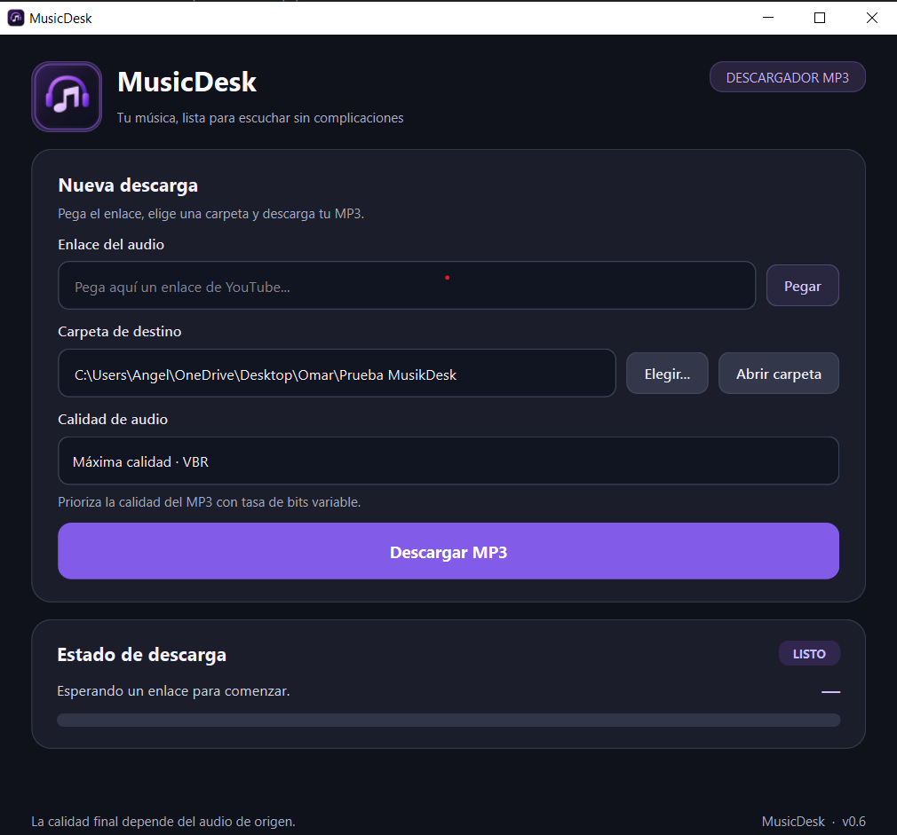

# MusicDesk

MusicDesk is a desktop application developed with **Python and PySide6** that provides a simple graphical interface for managing audio downloads.

The project was created as a personal learning project to practice desktop application development, background tasks, persistent settings, file management and application packaging.

## Features

- Desktop graphical interface built with **PySide6 / Qt**
- Audio downloads using **yt-dlp**
- Background downloads using **QThread**
- Audio quality selection
- Custom download folder selection
- Persistent download folder using **QSettings**
- Direct access to the selected download folder
- Download progress bar
- Status and error messages
- FFmpeg validation
- Windows executable generation

## Screenshot



## Technologies

- Python
- PySide6
- Qt
- yt-dlp
- FFmpeg
- QThread
- QSettings
- PyInstaller

## Requirements

Before running MusicDesk, make sure you have:

- Python 3 installed
- FFmpeg installed
- FFmpeg and FFprobe available in the system `PATH`

Install the Python dependencies with:

```bash
pip install -r requirements.txt
```

The `requirements.txt` file should include:

```text
PySide6
yt-dlp
pyinstaller
```

## Run the application

Run MusicDesk with:

```bash
python main_qt_v0_6.py
```

The application will open the graphical interface where you can:

1. Paste a media URL.
2. Select the destination folder.
3. Select the desired audio quality.
4. Start the download.
5. Monitor the download progress.
6. Open the destination folder directly from the application.

## Build the Windows executable

The project includes a batch file to generate a standalone Windows executable.

Run:

```bat
crear_exe_v0_6.bat
```

The build process uses **PyInstaller**.

After the process finishes, the generated executable should be available inside:

```text
dist/
```

Depending on the build configuration, FFmpeg may also be included or detected by the application.

## Project Structure

```text
MusicDesk/
│
├── main_qt_v0_6.py
├── worker_qt.py
├── downloader.py
├── crear_exe_v0_6.bat
├── compilar_v0_6.py
├── MusicDesk.ico
├── MusicDesk.png
├── requirements.txt
├── README.md
├── .gitignore
│
└── assets/
    └── musicdesk.png
```

### `main_qt_v0_6.py`

Contains the main graphical interface of MusicDesk.

It manages:

- User input
- Folder selection
- Audio quality selection
- Persistent application settings
- Progress visualization
- Status messages
- Download thread execution

### `worker_qt.py`

Handles the background download process using **QThread**.

This prevents the graphical interface from freezing while a download is running.

### `downloader.py`

Contains the download logic and integration with **yt-dlp** and FFmpeg.

### `crear_exe_v0_6.bat`

Windows batch script used to simplify the executable build process.

## Background Processing

MusicDesk uses Qt threads to execute downloads without blocking the main graphical interface.

The basic flow is:

```text
User Interface
      |
      v
main_qt_v0_6.py
      |
      v
worker_qt.py
      |
      v
downloader.py
      |
      v
yt-dlp + FFmpeg
```

The worker sends progress, status and error information back to the graphical interface using Qt signals.

## Persistent Settings

MusicDesk uses `QSettings` to remember the last valid download folder selected by the user.

This allows the application to restore the folder automatically when it is opened again.

## Project Status

The application is currently functional and includes the main features originally planned for the project.

Future improvements may include:

- Improved error handling
- Additional download formats
- Download history
- Multiple simultaneous downloads
- Improved packaging and installer
- Additional interface customization

## Purpose

This project was developed to strengthen my knowledge of:

- Python application development
- Desktop graphical interfaces
- Object-oriented programming
- Background processing
- Event-driven programming
- File and directory management
- External tool integration
- Application packaging

## Author

**Angel Abraham Padron Torres**

Computer Engineering student interested in software development, SQL, data processing and automation.